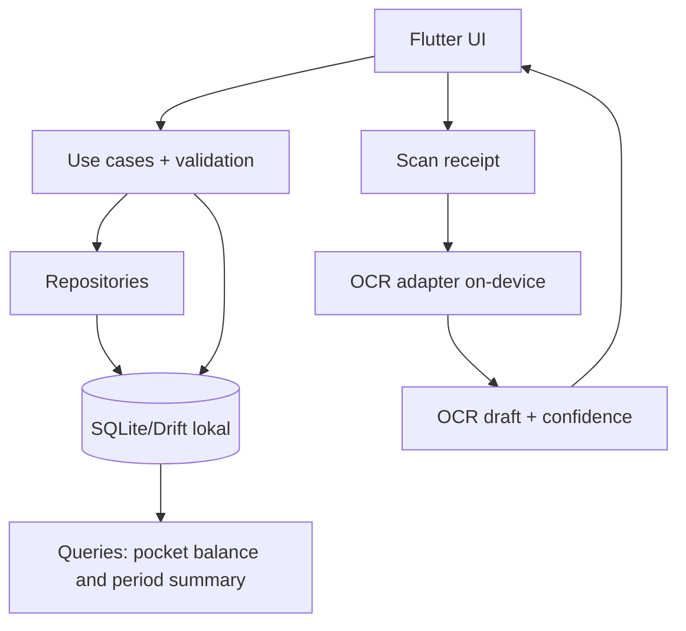

# Arsitektur teknis awal

## Keputusan baseline
Target awal adalah Flutter. UI memanggil use case/domain service; repository mengisolasi penyimpanan. Implementasi database diasumsikan SQLite melalui Drift. OCR dipanggil sebagai adapter on-device dan tidak boleh memiliki jalur cloud fallback. **Menunggu PBD-25:** validasi framework, library SQLite, OCR engine/model, lisensi, ukuran aplikasi, dan benchmark akurasi.

## Diagram alur

Tidak ada API server, analytics, remote logging, atau cloud storage pada MVP. Gambar struk hanya disimpan bila pengguna memilihnya dan memiliki kebijakan retensi lokal.

## Batas modul
- `presentation`: layar, navigasi, state loading/error/empty.
- `domain`: entity, validasi, use case transaksi/Kantong/OCR.
- `data`: Drift tables, DAO, repository adapter, migration.
- `ocr`: kamera/image preprocessing dan engine adapter; output terstruktur, bukan akses database langsung.
- `platform`: secure local settings, filesystem, connectivity assertion.

## Data model
```mermaid
erDiagram
  POCKET ||--o{ TRANSACTION : contains
  CATEGORY ||--o{ TRANSACTION : classifies
  TRANSACTION ||--o| OCR_RESULT : sourced_from
  POCKET { string id PK; string name; string color; int allocation_minor; string currency; datetime created_at; datetime archived_at }
  CATEGORY { string id PK; string name; bool system; datetime created_at }
  TRANSACTION { string id PK; string pocket_id FK; string category_id FK; string type; int amount_minor; string currency; date occurred_on; string merchant; string note; string source; datetime created_at; datetime updated_at }
  OCR_RESULT { string id PK; string transaction_id FK; string raw_text; string suggested_total; string suggested_date; string suggested_merchant; int confidence; string status; datetime created_at }
```

## Invariants dan persistence
- ID dibuat lokal; amount adalah integer minor unit dan currency wajib konsisten.
- Foreign key aktif; transaksi tidak menghapus Kantong secara cascade. Kantong diarsipkan agar riwayat tetap utuh.
- `source` bernilai `manual` atau `ocr`; OCR result berstatus `draft`, `confirmed`, atau `discarded`.
- Simpan transaksi dalam satu database transaction. Unique idempotency key untuk konfirmasi OCR mencegah duplikasi retry.
- Query saldo: alokasi + pemasukan - pengeluaran, dengan filter Kantong dan periode yang eksplisit.
- Migration versioned; backup/restore dan enkripsi database ditunda ke v0.2 setelah riset kebutuhan perangkat.

## Alur OCR
1. Pengguna memberi izin kamera dan mengambil gambar.
2. Preprocessing dan OCR berjalan lokal.
3. Parser mengekstrak field kandidat tanpa menimpa data pengguna.
4. UI menampilkan draft dan field yang perlu koreksi.
5. Pengguna memilih Kantong/kategori dan mengonfirmasi.
6. Use case menyimpan transaksi + OCR result secara atomik.

## Keamanan dan privasi
Izin kamera diminta just-in-time; log tidak boleh berisi nominal, merchant, gambar, atau raw OCR. Semua error yang ditampilkan tidak membocorkan path lokal. Dependensi dan lisensi harus dicatat setelah PBD-25; tidak ada secret di repo.

## Testing minimum
Unit test untuk perhitungan saldo, validasi, parser OCR, dan idempotensi; repository test untuk migration/foreign key; integration test untuk alur scan-koreksi-simpan dan offline relaunch. CI nantinya menjalankan lint, format, dan test; implementasi belum termasuk issue ini.

## Struktur repo yang disepakati
```text
lib/                 # aplikasi Flutter (saat implementasi dimulai)
test/                # unit dan integration tests
docs/                # PRD, story, arsitektur, roadmap
.github/              # issue/PR templates dan metadata
CONTRIBUTING.md
```
